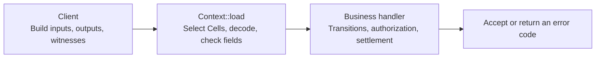

# Framework Documentation

CKB Cell Framework organizes contract development around four tasks: define data,
declare the required Cells, validate business rules, and construct and test
transactions. This guide uses the current repository APIs and links to their
implementations and runnable examples.

## Reading path

| Chapter | What you will learn |
|---|---|
| [Getting Started](getting-started.md) | Build Counter, run tests, and generate a contract |
| [Program Structure](program-structure.md) | Write entry points and handlers for creation and updates |
| [Cells and Context](cells-and-context.md) | Use `Cell<T>`, optional Cells, and declarative constraints |
| [State and Codecs](state-and-codecs.md) | Generate State and Action codecs and write pure transitions |
| [Transaction Construction](transactions.md) | Build outputs and witnesses with single- and multiple-reserve builders |
| [Testing and IDL](testing-and-idl.md) | Test acceptance and rejection paths and export data and collection descriptions |
| [API and Command Reference](reference.md) | Find commands, validation helpers, and error codes |

For your first contract, complete Getting Started, then read Program Structure
and Cells and Context. For asset contracts, continue with Transaction Construction
and the relevant business example.

## Key types

| Type or macro | Purpose |
|---|---|
| `#[derive(CellCodec)]` | Generate encoding, decoding, and an encoding schema |
| `#[derive(Cells)]` | Generate `load` and `schema` for a named-field collection |
| `Cell<T>` | A selected, checked, and decoded Cell |
| `Context<C>` | The framework container holding `cells: C` and the executing `script` |
| `StateTransition` | A pure Rust interface for computing the expected state from an Action |
| `InputAuthority` | Check for an input with a matching Lock hash; that input's Lock performs authorization |

Applications choose their data names, reserves, script arguments, and output
positions. Concrete Cell collections and explicit validation define each
protocol; the framework does not require a State/Reserve or role-based layout.

## Continue with examples

- [Counter source](../examples/counter/contract/src/lib.rs): the introductory protocol and scaffold template.
- [Vault](../examples/vault/README.md): asset custody and exact owner balance flows.
- [Escrow](../examples/escrow/README.md): operation-specific actors and recipients.
- [Vesting source](../examples/vesting/contract/src/lib.rs): bind claim times to the actual input's `since`.
- [Limit Order](../examples/limit-order/README.md): multiple parties, partial fills, and rounding.
- [AMM](../examples/amm/README.md): multiple reserves and State-Type-authorized xUDT LP tokens.
