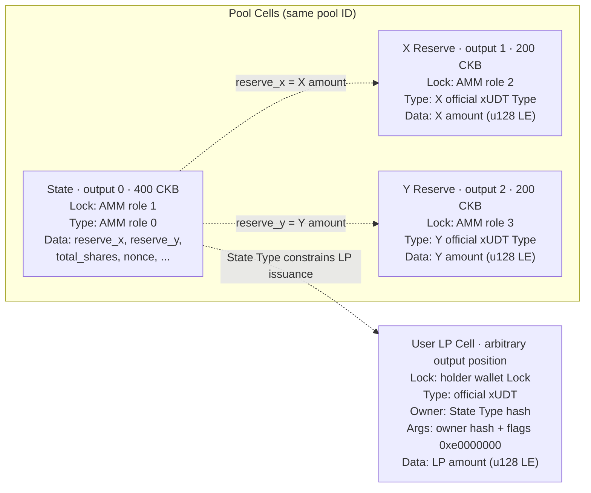
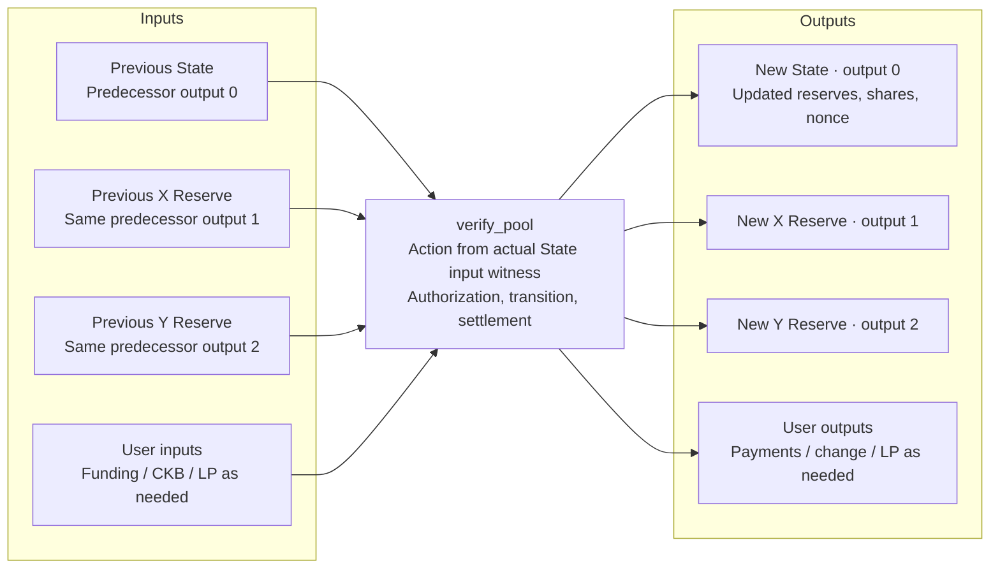

# Constant-product AMM

A two-asset constant-product AMM using the current `Context<PoolCells>`,
`#[derive(Cells)]`, and `#[derive(CellCodec)]` APIs. It supports pool creation,
multiple liquidity providers, adding and removing liquidity, X-to-Y and Y-to-X
swaps, and ordinary LP token transfers. See [`tests/src/amm.rs`](../../tests/src/amm.rs)
for transaction construction and complete lifecycles.

## Files

- [`contract/src/state.rs`](contract/src/state.rs): State, Action, quotes, and pure transitions.
- [`contract/src/cells.rs`](contract/src/cells.rs): six Cell fields and explicit protocol checks.
- [`contract/src/lib.rs`](contract/src/lib.rs): dispatch, `verify_pool(Context<PoolCells>)`, settlement, and the `lp_type` constructor for the official xUDT LP script.
- [`contract/tests/state.rs`](contract/tests/state.rs): arithmetic, boundaries, rounding, and codec tests.

`Context::load` selects and decodes Cells and checks field constraints. The
handler then explicitly calls `verify_protocol` and `verify_settlement` to check
transitions, reserve provenance, authorization, supply, and actual payments.
All AMM economics are defined by this example.

## Cells and identity

The pool ID is `entity_id(first_input, 0)`. Scripts belonging to the AMM binary
use `role:u8 || pool_id:[u8;32]` args. This layout is an application choice.

| Cell / script | Role | Output position | Capacity |
|---|---:|---:|---:|
| State Type | 0 | 0 | 400 CKB |
| State Lock | 1 | The same State Cell | Included above |
| X Reserve Lock | 2 | 1 | 200 CKB |
| Y Reserve Lock | 3 | 2 | 200 CKB |
| LP Type (official xUDT) | No AMM role | Arbitrary user output | Supplied by caller |

Each pool operation consumes and recreates State, X Reserve, and Y Reserve.
The three inputs must come from outputs 0/1/2 of the same predecessor
transaction. The State may appear at any input position in the current
transaction. Its Action is stored in that actual input's `WitnessArgs.input_type`.
Off-chain `ResolvedLayout` and `ContextTx` use the same `LAYOUT`.

Both reserve assets use official plain xUDT. Their full Type Scripts are matched
exactly, preserving the identity of original 32-byte and 36-byte args. Reserves
and user balances involved in pool accounting use exact 16-byte little-endian
`u128` amounts, with no trailing data. Asset descriptors, creator, and pool ID
remain fixed; `nonce` increases on every update.

`creator` identifies only the wallet Lock hash that supplies both initial assets
and receives the initial LP. It grants no administrative rights. Any external
wallet may swap or add liquidity, and LP holders may redeem their own LP.
Each operation requires an actor input authorized by its Lock and checks that
Lock hash's net balances.

## Cell diagrams

The pool has three fixed output Cells. User LP tokens live in separate official
xUDT Cells. Dashed edges show validation or authorization relationships; only
the main State data fields are shown.



Adding liquidity, removing liquidity, or swapping in an existing pool consumes
the old three Cells and creates a successor set. Input positions are flexible:
0/1/2 below refer to predecessor outputs and new output positions.



Creation has no previous pool Cells: the creator supplies both assets and
receives initial LP. Swaps do not require LP holdings. An ordinary LP transfer
spends user LP Cells without consuming or recreating the pool.

## Arithmetic and slippage bounds

All amounts use token base units; on-chain calculations do not handle decimals.
Let `x/y` be the previous reserves and `S` the total accounting shares, including
permanent shares:

| Operation | Rule |
|---|---|
| Creation | `S = floor(sqrt(x*y))`; mint `S - 1000` LP to the creator |
| Add `s` shares | Pay `ceil(s*x/S)` and `ceil(s*y/S)`, bounded by `max_x/max_y` |
| Remove `s` shares | Receive `floor(s*x/S)` and `floor(s*y/S)`, bounded below by `min_x/min_y` |
| X-to-Y with input `a` | `out = floor(a*9970*y / (x*10000 + a*9970))`, at least `min_out` |
| Y-to-X | Exchange X and Y in the swap formula |

The swap fee is 0.3% of input and stays entirely in the reserves for LP holders;
there is no protocol fee. Zero shares, zero input, outputs rounded to zero, and
violated slippage bounds are rejected. Reserves and total shares are capped at
`2^112 - 1`; multiplication and division use the framework's `U256` and integer
rounding helpers.

The swap formula follows [Uniswap V2's quote implementation](https://github.com/Uniswap/v2-periphery/blob/master/contracts/libraries/UniswapV2Library.sol).
Initial square-root shares and minimum liquidity are inspired by its
[Pair implementation](https://github.com/Uniswap/v2-core/blob/master/contracts/UniswapV2Pair.sol).
This example represents minimum liquidity with **1000 virtual shares that are
never minted and cannot be redeemed**. `total_shares` records the initial square
root plus subsequent issuance minus shares redeemed through the pool. Without
standalone LP burns, `total_shares = circulating_lp + 1000`.

Assets remain in the pool after all holders redeem, and liquidity can be added
again. There is no close operation: the pool's 800 CKB remains locked permanently.

## LP Type and settlement

LP uses the **official xUDT binary**, `hash_type = data1`, and a little-endian
`u128` amount. Its 36-byte args contain the pool's full State Type hash and owner
flags, constructed by `lp_type(state_type)`:

```text
args = hash(pool_state_type) || LE32(0xe0000000)
```

These high-bit flags use native xUDT Type-owner authorization without extension
scripts:

| Flag | Meaning |
|---|---|
| `0x20000000` | Disable input Lock hash authorization |
| `0x40000000` | Enable matching output Type hash authorization for initial issuance |
| `0x80000000` | Enable matching input Type hash authorization for later issuance |

The [xUDT Owner Mode specification](https://github.com/nervosnetwork/rfcs/blob/master/rfcs/0052-extensible-udt/0052-extensible-udt.md#owner-mode-update)
defines these settings. Creation and liquidity additions execute the matching
State Type, which checks exact LP issuance and the actor's net balance. Placing
the State script in an output Lock does not authorize issuance. The creator's
wallet is not the LP owner and has no independent minting authority.

Pool operations exempt only the **current pool's full LP Type hash** from the
standard net issuance guard. Settlement still checks exact supply changes.
Different owners, flags, or hash types are not exempt. Both reserve assets must
conserve supply, and actual reserve amounts and actor X/Y/LP flows must match the
quote. Wallet Locks control user LP Cells; ordinary transfers do not consume the
pool. Clients must preserve the full 36-byte args and their owner flags.

Standard xUDT also permits holders to **voluntarily burn LP outside the pool**.
This is not liquidity redemption: it pays no reserves, changes no pool state,
and does not reduce the `total_shares` pricing denominator. Burned LP permanently
loses its redemption rights; those accounting shares remain in the denominator
and cannot be claimed by later holders or depositors. Circulating LP can then be
less than `total_shares - 1000`. To redeem assets, use `RemoveLiquidity`, which
checks the exact LP burn and receipt of both reserve assets.

Public pool Locks cannot authorize unrelated net xUDT/sUDT issuance. State and
LP Types cannot be used as input Locks in pool operations. Each transaction
supports one pool from the deployment. The example has no multi-hop routing,
flash swaps, oracle, or frontend.

## Run

From the repository root:

```sh
cargo test -p framework-amm-script
cargo cell build framework-amm-script
python3 scripts/fetch-udt.py
cargo test -p framework-vm-tests --features vm-tests amm::
```

`cargo cell test` automatically includes this example's build, pure tests, and
VM tests. VM tests use testkit wallets and the official xUDT binary locally,
without network deployment.
