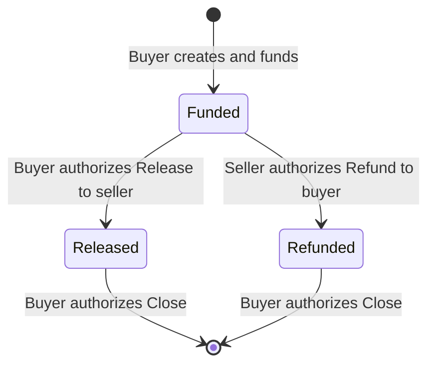
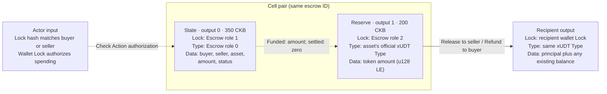

# Two-party Escrow

A fixed-amount, two-party xUDT escrow using the current `Context<EscrowCells>`,
`#[derive(Cells)]`, and `#[derive(CellCodec)]` APIs. The buyer creates and funds
the escrow. The buyer can then authorize payment to the seller, or the seller
can authorize a refund to the buyer. After settlement, the buyer closes the
escrow and recovers its CKB capacity.

See [`tests/src/escrow.rs`](../../tests/src/escrow.rs) for complete transaction
construction and VM tests.

## Files

- [`contract/src/state.rs`](contract/src/state.rs): State, Status, Action, pure transitions, and settlement calculations.
- [`contract/src/cells.rs`](contract/src/cells.rs): `EscrowArgs`, four Cell fields, and explicit protocol checks.
- [`contract/src/lib.rs`](contract/src/lib.rs): dispatch, `verify_order(Context<EscrowCells>)`, token settlement, and capacity refunds.
- [`contract/src/main.rs`](contract/src/main.rs): CKB-VM startup.
- [`contract/tests/encoding.rs`](contract/tests/encoding.rs): independent protocol byte vectors.

`Context::load` selects and decodes Cells and checks declared capacity, Lock,
and output-position constraints. The handler explicitly calls `verify_protocol`
and `verify_settlement` to verify lifecycle rules, transitions, reserve provenance,
actor authorization, and actual payments. The client constructs outputs; the
framework does not modify them.

## State and operations

`State` stores `buyer`, `seller`, `asset`, `amount`, and `status`. Buyer and seller
are distinct, nonzero wallet Lock hashes. `amount` must be positive and uses token
base units. Parties, asset, and amount are immutable after creation; settlement
changes only status.

| Operation | Authorized by | Transition | Asset flow |
|---|---|---|---|
| Create | Buyer | None → `Funded` | Buyer pays exactly `amount` into the Reserve |
| `Release` | Buyer | `Funded` → `Released` | Reserve pays the full `amount` to the seller |
| `Refund` | Seller | `Funded` → `Refunded` | Reserve returns the full `amount` to the buyer |
| `Close` | Buyer | `Released` / `Refunded` → None | Consume State and zero-balance Reserve; recover CKB |



`Release` and `Refund` are mutually exclusive, one-time settlements of the full
principal. Both retain the State and a zero-token Reserve until a separate
`Close`. A `Funded` escrow cannot close directly; terminal states cannot settle
again.

The buyer cannot unilaterally refund themselves, and the seller cannot
unilaterally pay themselves. This example has no partial settlement, timeout
refund, arbitration, or dispute resolution. It has no automatic unlock path if
the parties do not cooperate.

## Cells and identity

The instance ID is `entity_id(first_input, 0)`. Args use
`role:u8 || escrow_id:[u8;32]` with no additional payload. All three roles share
one binary. Roles, fixed output positions, and capacities are application policy.

| Cell / script | Role | Output position | Capacity |
|---|---:|---:|---:|
| State Type | 0 | 0 | 350 CKB |
| State Lock | 1 | The same State Cell | Included above |
| Reserve Lock | 2 | 1 | 200 CKB |



Dashed edges show constraints and authorization; the solid edge shows token
settlement. The public State Lock requires its input to carry the matching
State Type. The Reserve Lock requires the transaction to consume that State.
The State Type verifies business rules and actor permissions.

Creation produces a Cell pair. Settlement consumes it and produces a successor
pair. Closing consumes both and produces no escrow Cells. Each side must contain
exactly one matching Reserve whenever a State exists. Deployment-wide role
counts reject additional role Cells or Cells from other instances.

The State input must reference predecessor output 0; its Reserve must reference
output 1 of the **same predecessor transaction**. Their current input positions
may vary. The Action comes from the actual State input's
`WitnessArgs.input_type`, not a hard-coded input 0 witness.

## Assets, authorization, and settlement

The asset is official `data1` plain xUDT, using either original 32-byte args or
36-byte args with zero flags. The full Type Script is matched exactly. These
forms retain distinct identities rather than being normalized into one asset.
`asset.owner` is the xUDT issuance owner parameter, separate from the buyer and
seller in this escrow.

Reserve and user Cells included in party balance accounting use exact 16-byte
little-endian `u128` amounts, without trailing data. Token principal and CKB
capacity are accounted separately: the escrow pair occupies 550 CKB, while
Reserve data records the principal.

Settlement aggregates inputs and outputs for each party's wallet Lock hash and
asset across the whole transaction, including change:

- Creation: the buyer spends exactly `amount`; the seller's token balance is unchanged.
- Release: the seller receives exactly `amount`; the buyer's token balance is unchanged.
- Refund: the buyer receives exactly `amount`; the seller's token balance is unchanged.
- Close: both parties' token balances for the asset are unchanged.

The escrow asset conserves supply, so minting or burning cannot hide missing
payments. The contract also rejects net issuance of all official xUDT/sUDT in the
transaction, preventing public escrow Locks from authorizing issuance. The State
Type cannot be used as an input Lock.

The actor must provide a real input with a matching full Lock hash; its Lock
performs authorization. `InputAuthority::load_external` also excludes this
protocol's public code and Type-hash aliases, preventing public Locks from
impersonating buyer or seller wallets.

Closing requires buyer authorization and checks the buyer's **net CKB gain**:

```text
buyer_output_capacity - buyer_input_capacity + transaction_fee >= 550 CKB
```

The transaction fee may be deducted from the refunded capacity. Buyer-owned
funding inputs cannot be counted again as an escrow capacity refund. State and
Reserve disappear together; even a zero-token Reserve cannot be spent separately
to extract its CKB.

## Encoding and tests

`State`, `Status`, and `Action` derive `CellCodec`; integers use little-endian
encoding. State has prefix `ESC01` and is 119 bytes. Action has prefix `ESA01`
followed by a tag: `Release = 0`, `Refund = 1`, `Close = 2`. Status tags are
`Funded = 0`, `Released = 1`, and `Refunded = 2`. Decoders reject wrong prefixes,
invalid tags, truncated data, and trailing bytes.

Pure tests cover actor selection, immutable terms, terminal states, amount
boundaries, and strict encoding. VM tests cover complete release/refund/close
lifecycles for both xUDT args forms, plus invalid authorization, redirected or
insufficient payments, tampered state, forged reserve origins, duplicate Cells,
wrong witnesses, insufficient capacity refunds, and public-Lock token issuance.

From the repository root:

```sh
cargo test -p framework-escrow-script
cargo cell build framework-escrow-script
python3 scripts/fetch-udt.py
cargo test -p framework-vm-tests --features vm-tests escrow::
```

`cargo cell test` includes this example's build, pure tests, and VM tests.
VM fixtures use testkit `ALWAYS_SUCCESS` wallets and the official xUDT binary
locally. Real transactions rely on each party's wallet Lock for signatures and
other authorization checks.
