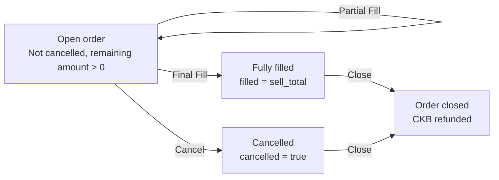
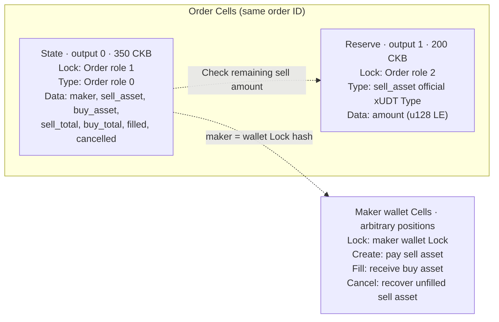

# Fixed-price Limit Order

A two-asset fixed-price order using the current `Context<OrderCells>`,
`#[derive(Cells)]`, and `#[derive(CellCodec)]` APIs. The maker locks the sell
asset; takers pay the buy asset at the agreed ratio, in one fill or several
partial fills. The maker can cancel the unfilled portion and close the order
after it ends to recover CKB.

See [`tests/src/limit_order.rs`](../../tests/src/limit_order.rs) for complete
transaction construction and VM tests.

## Files

- [`contract/src/state.rs`](contract/src/state.rs): State, Action, integer quotes, fill progress, and cancellation rules.
- [`contract/src/cells.rs`](contract/src/cells.rs): `OrderArgs`, four Cell fields, and explicit protocol checks.
- [`contract/src/lib.rs`](contract/src/lib.rs): dispatch, `verify_order(Context<OrderCells>)`, party settlement, and capacity refunds.
- [`contract/src/main.rs`](contract/src/main.rs): CKB-VM startup.
- [`contract/tests/encoding.rs`](contract/tests/encoding.rs): independent protocol byte vectors.

`Context::load` selects and decodes Cells and checks declared capacity, Lock,
and output-position constraints. The handler explicitly calls `verify_protocol`
and `verify_settlement` to verify lifecycle rules, transitions, reserve provenance,
actor authorization, and actual asset flows. The client builds the transaction;
the contract validates its inputs, outputs, and witnesses.

## State and operations

| State field | Meaning |
|---|---|
| `maker` | Maker wallet's full, nonzero Lock hash |
| `sell_asset` / `buy_asset` | Distinct plain xUDT sell and buy asset descriptors |
| `sell_total` / `buy_total` | Positive original totals defining the fixed price ratio |
| `filled` | Sell-asset units already filled; initially zero and at most `sell_total` |
| `cancelled` | Whether cancellation has occurred; initially false |

Maker, assets, and original totals are immutable. Filling only increases `filled`;
cancellation only sets `cancelled` to true. There is no separate status enum or
nonce field.

| Operation | Authorized by | Preconditions and changes | Asset flow |
|---|---|---|---|
| Create | Maker | `filled = 0, cancelled = false` | Maker pays the full `sell_total` into the Reserve |
| `Fill { taker, amount }` | Taker | Not cancelled; `0 < amount <= sell_total - filled`; `filled += amount` | Taker receives `amount` sell units; maker receives the quoted buy units |
| `Cancel` | Maker | Not cancelled and not fully filled; preserve `filled`, mark cancelled | Return all unfilled sell units to maker |
| `Close` | Maker | Fully filled or cancelled | Consume State and zero-token Reserve; recover CKB |



Creation needs no taker. Filling needs no new maker signature, but the taker must
provide an authorized input and must be nonzero and different from the maker.
Only the maker can cancel or close. Both cancellation and full filling retain
State and a zero-token Reserve until a separate `Close`. Terminal orders cannot
fill or cancel again, and an unfinished order cannot close directly.

## Price and rounding

For `a` sell units in the current fill, the required buy-asset payment is:

```text
payment = ceil(a * buy_total / sell_total)
```

The original ratio remains fixed after partial fills. Amounts use token base
units without on-chain decimal handling. The framework's `mul_div_ceil` and
`U256` avoid intermediate product overflow. Each fill rounds up independently,
so a positive fill costs at least one buy-asset base unit. Splitting cannot
reduce total payment, but it may make cumulative maker receipts exceed
`buy_total`.

For an order selling 100 X for 201 Y:

| Fill strategy | Y per fill | Total Y |
|---|---|---:|
| One fill of 100 X | 201 | 201 |
| Fills of 30, 20, and 50 X | 61, 41, 101 | 203 |

The contract requires the exact net payment for each quote. The example has no
protocol fee, expiration, automatic matching, or repricing. The client arranges
transaction CKB fees.

## Cells and identity

The order ID is `entity_id(first_input, 0)`. Args use
`role:u8 || order_id:[u8;32]` with no additional payload. All three roles share
one binary. Roles, fixed output positions, and capacities are application policy.

| Cell / script | Role | Output position | Capacity |
|---|---:|---:|---:|
| State Type | 0 | 0 | 350 CKB |
| State Lock | 1 | The same State Cell | Included above |
| Reserve Lock | 2 | 1 | 200 CKB |

The order reserves only the sell asset. Fill payments go directly to the maker,
not to a second order reserve. Dashed edges show reserve and maker identity
constraints.



Before cancellation, the Reserve must contain `sell_total - filled`. After
cancellation it must contain zero. Cancellation preserves `filled`, so
`remaining()` still reports the unfilled quantity while `reserve_amount()`
returns zero: the refunded assets have left the order.

Creation produces a pair. Each fill or cancellation consumes it and creates a
successor pair. Closing consumes both and produces no order Cells. Each side
must contain exactly one matching Reserve whenever a State exists.
Deployment-wide role counts reject additional role Cells or Cells from other
orders.

The State input must reference predecessor output 0; its Reserve must reference
output 1 of the **same predecessor transaction**. Their current input positions
may vary. The Action comes from the actual State input's
`WitnessArgs.input_type`, not a hard-coded input 0 witness.

The public State Lock requires its input to carry the matching State Type.
The Reserve Lock requires the transaction to consume that State. The State
Type verifies business rules and actor permissions.

## Assets, authorization, and settlement

Both assets use official `data1` plain xUDT, with original 32-byte args or
36-byte args with zero flags. Full Type Scripts are matched exactly. These args
forms retain distinct identities; different raw args identify different assets
even with the same xUDT owner parameter. Token issuance owner parameters are
separate from maker and taker wallet identities.

Reserve and user Cells included in party balance accounting use exact 16-byte
little-endian `u128` amounts, without trailing data. CKB capacity and tokens are
accounted separately; the live order pair occupies 550 CKB.

Settlement aggregates all inputs and outputs for the relevant asset and wallet
Lock hash, including change:

- Creation: maker spends exactly `sell_total`; their buy-asset balance is unchanged.
- Fill: taker spends `payment` buy units and receives `amount` sell units; maker receives `payment` buy units and their sell-asset balance is unchanged.
- Cancel: maker receives all unfilled sell units; their buy-asset balance is unchanged.
- Close: maker balances for both assets are unchanged.

These checks reject maker inputs posing as taker payment, taker-owned sell inputs
posing as order delivery, and payments, delivery, or cancellation refunds
redirected to third parties. Both order assets conserve supply. The contract
also rejects net issuance of all official xUDT/sUDT in the transaction to prevent
public order Locks from authorizing issuance. The State Type cannot be used as
an input Lock.

The actor must provide a real input with a matching full Lock hash; its Lock
performs authorization. `InputAuthority::load_external` also excludes this
protocol's public code and Type-hash aliases, preventing public Locks from
impersonating maker or taker wallets.

Closing checks the `Close` Action, terminal state, and zero-token Reserve, then
requires the maker's **net CKB gain** to satisfy:

```text
maker_output_capacity - maker_input_capacity + transaction_fee >= 550 CKB
```

The transaction fee may be deducted from the refunded capacity. Maker funding
inputs cannot be counted again as an order capacity refund. State and Reserve
must disappear together; Reserve tokens or CKB cannot be spent separately.

## Encoding and tests

State and Action derive `CellCodec`; integers use little-endian encoding. State
has prefix `LOR01` and is 152 bytes. Action has prefix `LOA01` followed by a tag:
`Fill = 0`, `Cancel = 1`, `Close = 2`. Fill also carries a 32-byte taker Lock hash
and a 16-byte amount, for 54 bytes total. Cancel and Close are each 6 bytes.
Decoders reject wrong prefixes, invalid tags or bools, truncated data, and
trailing bytes.

Pure tests cover partial fills, cancellation, terminal states, per-fill rounding,
amount boundaries, strict encoding, and independent byte vectors. VM tests cover
all combinations of both assets' 32/36-byte args, consecutive fills by multiple
takers, and rejection of wrong actors, self-trades, zero-payment rounding attacks,
underpayment, redirected delivery, insufficient refunds, tampered state, forged
reserve origins, wrong witnesses, capacity theft, and public-Lock token issuance.

From the repository root:

```sh
cargo test -p framework-limit-order-script
cargo cell build framework-limit-order-script
python3 scripts/fetch-udt.py
cargo test -p framework-vm-tests --features vm-tests limit_order::
```

`cargo cell test` includes this example's build, pure tests, and VM tests.
VM fixtures use testkit `ALWAYS_SUCCESS` wallets and the official xUDT binary
locally. Real transactions rely on maker or taker wallet Locks for signatures
and other authorization checks.
