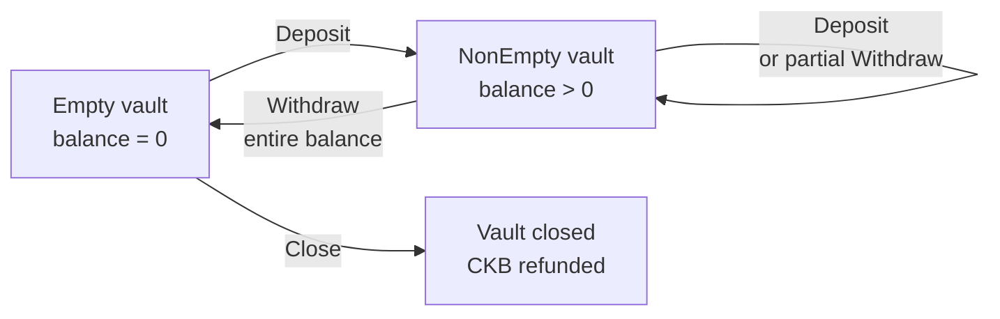
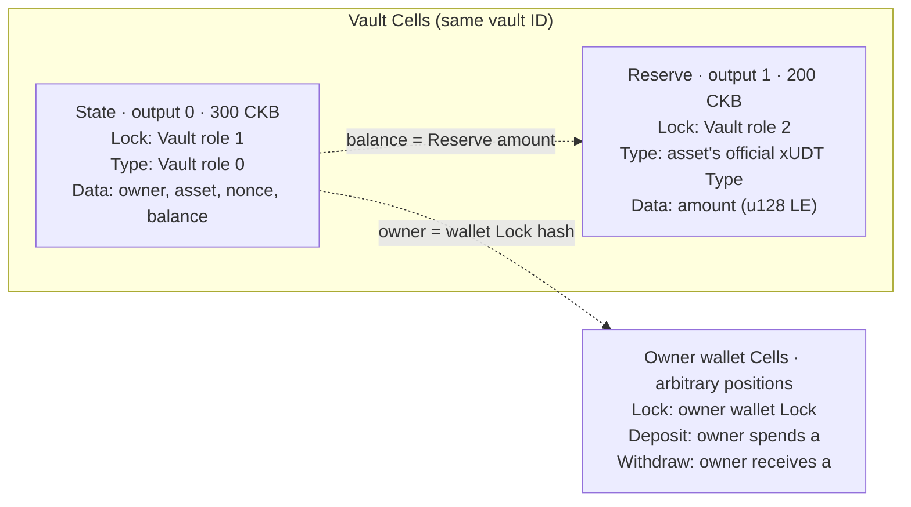

# Owner Vault

A single-owner, single-asset xUDT vault using the current `Context<VaultCells>`,
`#[derive(Cells)]`, and `#[derive(CellCodec)]` APIs. The owner creates an empty
vault, deposits and withdraws repeatedly, then closes it at zero balance to
recover the Cells' CKB capacity.

The vault tracks principal, earns no interest, and issues no shares or receipt
tokens. See [`tests/src/vault.rs`](../../tests/src/vault.rs) for complete transaction
construction and VM tests.

## Files

- [`contract/src/state.rs`](contract/src/state.rs): State, Action, and balance/nonce transitions without syscalls.
- [`contract/src/cells.rs`](contract/src/cells.rs): `VaultArgs`, four Cell fields, and explicit protocol checks.
- [`contract/src/lib.rs`](contract/src/lib.rs): dispatch, `verify_account(Context<VaultCells>)`, token settlement, and capacity refunds.
- [`contract/src/main.rs`](contract/src/main.rs): CKB-VM startup.
- [`contract/tests/encoding.rs`](contract/tests/encoding.rs): independent protocol byte vectors.

`Context::load` selects and decodes Cells and checks declared capacity, Lock,
and output-position constraints. The handler explicitly calls `verify_protocol`
and `verify_settlement` to check lifecycle rules, transitions, reserve provenance,
owner authorization, and actual asset flows. The client constructs outputs; the
contract verifies the proposed transaction.

## State and operations

`State` stores:

| Field | Meaning |
|---|---|
| `owner` | Owner wallet's full Lock hash |
| `asset` | Plain xUDT asset descriptor preserving its original args form |
| `nonce` | Deposit/withdrawal count; initially zero, incremented by each update |
| `balance` | Principal in token base units; initially zero |

Every operation requires owner authorization. `owner` and `asset` are immutable
after creation.

| Operation | Preconditions | State change | Token flow |
|---|---|---|---|
| Create | Correct instance ID | Create `balance = 0, nonce = 0` | Owner token balance unchanged; zero-token Reserve |
| `Deposit(a)` | `a > 0`; no balance or nonce overflow | `balance += a`, `nonce += 1` | Owner spends exactly `a`; Reserve increases by `a` |
| `Withdraw(a)` | `0 < a <= balance`; no nonce overflow | `balance -= a`, `nonce += 1` | Owner receives exactly `a`; Reserve decreases by `a` |
| `Close` | `balance = 0` | Consume State with no successor | Owner token balance unchanged; recover CKB |



`Empty` and `NonEmpty` describe zero and positive balances; State has no separate
status enum. An empty vault can accept another deposit or close immediately after
creation. A nonempty vault cannot close. Zero-value operations, overdrafts,
balance overflow, and nonce overflow are rejected.

## Cells and identity

The instance ID is `entity_id(first_input, 0)`. Args use
`role:u8 || vault_id:[u8;32]` with no additional payload. All three roles share
one binary. Roles, fixed output positions, and capacities are application policy.

| Cell / script | Role | Output position | Capacity |
|---|---:|---:|---:|
| State Type | 0 | 0 | 300 CKB |
| State Lock | 1 | The same State Cell | Included above |
| Reserve Lock | 2 | 1 | 200 CKB |

The vault has two fixed output Cells. Owner wallet Cells are separate. Dashed
edges show balance and identity constraints; the wallet input's Lock performs
authorization.



The wallet node represents funding inputs, receipts, and change, constructed for
the chosen operation. The public State Lock requires its input to carry the
matching State Type. The Reserve Lock requires the transaction to consume that
State. The State Type verifies business rules and owner permissions.

Creation produces a pair. Each deposit or withdrawal consumes it and creates a
successor pair. Closing consumes both and produces no vault Cells. A zero-token
Reserve remains until closing. Each side must contain exactly one matching
Reserve whenever a State exists. Deployment-wide role counts reject additional
role Cells or Cells from other instances.

The State input must reference predecessor output 0; its Reserve must reference
output 1 of the **same predecessor transaction**. Their current input positions
may vary. The Action comes from the actual State input's
`WitnessArgs.input_type`, not a hard-coded input 0 witness. Creation validates the
initial State and needs no separate Create Action.

## Assets, authorization, and settlement

The asset is official `data1` plain xUDT, using either original 32-byte args or
36-byte args with zero flags. The full Type Script is matched exactly. These
forms retain distinct identities rather than being normalized into one asset.
`asset.owner` identifies the token issuance owner; `State.owner` identifies the
vault's owner.

Reserve and user Cells included in owner balance accounting use exact 16-byte
little-endian `u128` amounts, without trailing data. CKB capacity and token
principal are accounted separately: the live pair occupies 500 CKB, while
Reserve data records the principal.

Settlement aggregates all inputs and outputs for the asset and owner Lock hash,
including change. Deposits require the owner to spend the full amount; third-party
funding cannot replace that payment. Withdrawals require the owner to receive the
full amount and cannot redirect it to another recipient. Creation and closing
leave the owner's token balance unchanged.

The vault asset conserves supply, so minting or burning cannot hide balance
mismatches. The contract also rejects net issuance of all official xUDT/sUDT in
the transaction, preventing public vault Locks from authorizing issuance. The
State Type cannot be used as an input Lock.

The owner must provide a real input with a matching full Lock hash; its Lock
performs authorization. `InputAuthority::load_external` also excludes this
protocol's public code and Type-hash aliases, preventing public Locks from
impersonating the owner wallet.

Closing checks the `Close` Action, zero principal, and zero-token Reserve, then
requires the owner's **net CKB gain** to satisfy:

```text
owner_output_capacity - owner_input_capacity + transaction_fee >= 500 CKB
```

The transaction fee may be deducted from the refunded capacity. Owner funding
inputs cannot be counted again as a vault capacity refund. State and Reserve
must disappear together; Reserve tokens or capacity cannot be spent separately,
and the close refund cannot be redirected to another party.

## Encoding and tests

State and Action derive `CellCodec`; integers use little-endian encoding. State
has prefix `VLT01` and is 94 bytes. Action has prefix `VLA01` followed by a tag:
`Deposit = 0`, `Withdraw = 1`, `Close = 2`. Deposit and Withdraw include a
16-byte amount, making them 22 bytes; Close is 6 bytes. Decoders reject wrong
prefixes, invalid tags or bools, truncated data, and trailing bytes.

Pure tests cover repeated deposits and withdrawals, immutable identity,
zero-balance closing, amount/nonce boundaries, strict encoding, and independent
byte vectors. VM tests cover complete lifecycles with both xUDT args forms, plus
invalid authorization, third-party deposits, redirected or underpaid withdrawals,
tampered state, forged reserve origins, duplicate Cells, wrong witnesses,
insufficient capacity refunds, and public-Lock token issuance.

From the repository root:

```sh
cargo test -p framework-vault-script
cargo cell build framework-vault-script
python3 scripts/fetch-udt.py
cargo test -p framework-vm-tests --features vm-tests vault::
```

`cargo cell test` includes this example's build, pure tests, and VM tests.
VM fixtures use testkit `ALWAYS_SUCCESS` wallets and the official xUDT binary
locally. Real transactions rely on the owner's wallet Lock for signatures and
other authorization checks.
